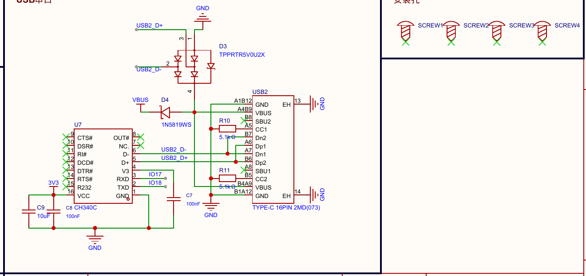
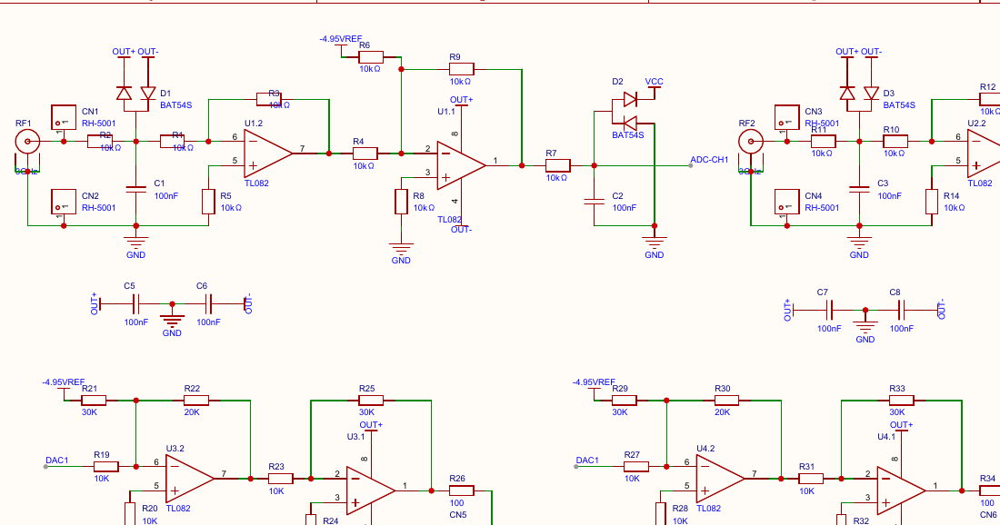
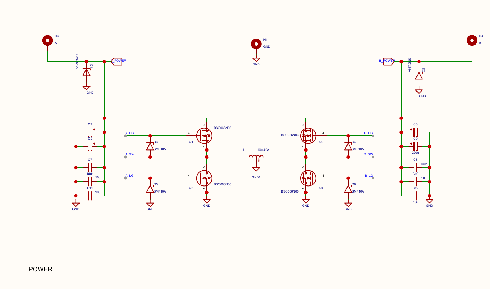

# 中文原理图绘图指导册

初版 0.1 · 2026-10-28 · 面向嘉立创 EDA 专业版。适用新建、重排与图面审查。此册学习的是组织语法；参考 PDF 不能作为连接基线或电气设计认证。

阅读入口：[已确认/待确认偏好](preferences.md) · [36 份资料与规则证据](evidence.md) · [EDA 操作与效率](easyeda-workflow.md) · [应用图与验证局限](validation.md)。R 编号为稳定引用；本册维护规则，其他文件引用编号，不另写一套同义规则。

## 1. 核心风格与选择方法

让读者先找到功能区，再看懂局部电路，最后能查到具体针脚。参考库中“有序模块构图”与“连续局部拓扑”并存：主控图可以有大片有序引脚映射，模拟或功率电路需要显露反馈、支路、桥臂和取样关系。风格统一来自字体、线条、命名、标注归属与分区节奏，而非让所有电路长得一样。

明确偏好只有 preferences 中的 P 项；图中反复出现的做法仍属于 I 项推断。以下每条规则末尾列来源性质，其文件/页码/可见证据/条件/例外/确认状态在 evidence 的同编号条目中。新任务先写一个简短的“采用规则与例外”清单。

| 眼前的阅读问题 | 先用哪些规则 | 先尝试什么 |
| --- | --- | --- |
| 一页看不出组织、大片无目的留白 | R01–R04、R14–R15 | 先安排功能组与阅读顺序，再调页幅和框 |
| 相邻器件靠标签连接、反馈难追 | R05–R06 | 摆好关键节点与支路，为返回路径留通道 |
| MCU、供电、接口各自像孤岛 | R07–R09 | 支持网络按归属组织，映射与实现分开阅读 |
| 多路像复制粘贴，但差异看不出 | R10、R13 | 复制完整单元，突出真实差异 |
| 图形整齐，文字仍挤或归属漂移 | R11–R12 | 连同字段占用重新分配局部空间 |
| 准备重排或宣称完成 | R16、实施流程 | 先锁电气基线，再分项验证 |

## 2. 页面与模块

### R01 先定阅读尺度，再定页面容器

**何时用**：所有新图、导出或分页调整。**怎么做**：先选能代表正文密度的核心区和一个小接口，在目标屏幕/打印比例下试排；保持正文可读，再围绕完整功能组决定页幅。复杂主控可以加宽或分页，小电源可以使用较小页幅；重排先沿用原生工程设置。**为什么**：同样的元件数，针名长度和反馈支路会占用不同空间。**调整条件**：屏幕总览与打印需求不同，任何方案都要比较查线跳转与局部阅读负担。**检查**：整页能定位功能，正常比例读得出位号/值/针号，密集区无需远小于其余页的字号。PDF MediaBox 尺寸只说明导出纸面，不是 EDA 单位；图签写 A4 也不能代替实测尺寸。依据 S005/S007/S012/S030，P05 已确认，具体阅读介质待项目指定。

### R02 模块由共同功能决定，空间服从内容

**何时用**：一个图面同时有主控、接口、供电、驱动等职责。**怎么做**：先列功能及依赖，主控/主路径获得足以放下针名和支路的空间；简短接口成组排列，相关供电或控制区与服务对象邻近；对齐相邻区的关键边界，允许大小不同。新图标题放左上，名称表示功能，如“CAN 收发器”或“输出反馈”，不默认用芯片型号作所有标题。**为什么**：先看到职责，再看到实现。**调整条件**：双向、桥式、共享资源不必围绕一个中心 IC；重排可保留已有合格标题位置，整体改样式再统一。**检查**：读者能说出每组的功能；框内没有无关支路，关键支路未被切出去。依据 S004/S005/S006/S011/S030，P04 已确认、I01/I02 待确认。

应用验证 B 的修订：无框功能区也应以其实际占用范围的左上作为标题锚点，统一左对齐；不能因信号走廊居中而单独使用居中模块标题。器件位号、引脚名和导线网络名可以采用各自的合理对齐，它们不属于模块标题。

### R03 按需分框，框是视觉边界

**何时用**：职责易混、内容交织或需要明确功能边界。**怎么做**：先利用邻近、对齐、留白和标题；仍不清楚再加统一、克制的图形框。框沿内容外缘留出标题和字段空间；相邻框可以对齐，但不为拼满页面而画等大空格。**为什么**：框能加速定位，也会增加硬边界和导航负担。**调整条件**：S021 的模拟链、S028 的功率路径可保持无框；隔离边界另标真实域名，视觉分框不代表电气隔离。**检查**：框线不穿过文字或割断支路；没有未说明的空框；不把图形矩形当层次电气接口。P04 已确认；框线线型/线宽未确认。

### R04 拓扑决定构图，不机械套左进右出

**何时用**：开始排一个功能区。**怎么做**：单向转换按输入、处理、输出的相对顺序；反馈在主链旁返回；低边/半桥/全桥保留共同节点及上下关系；差分或耦合成对对齐；双向电路两侧对等，不画虚假的单向箭头。**为什么**：位置本身应解释工作关系。**调整条件**：库引脚顺序限制时可以局部折返或采用必要标签，不能交换针脚来满足形状。**检查**：遮住普通节点名后仍能看出主要关系，但保留电源身份和必要端口信息；一眼能区分并联扇出与逐级级联。S021 连续两级、S027 左右负载对、S034 桥式对称、S032 p2 桥式传感器说明不同形状可以共存。工程方法，用户期望的具体对称程度仍待反馈。

## 3. 连线、供电与接口

### R05 局部主路径、设定与反馈要能沿线追踪

**何时用**：滤波、调理、功率转换、保护、驱动及其必要支路。**怎么做**：把串联元件顺着路径摆，分流/旁路支路贴近服务节点；先预留反馈和回流的独立通道。输出取样、分压中点和作用端优先直接连接；网络名可附在连续线上辅助检索。自举或电荷泵跨非地节点，按真实拓扑摆放。**为什么**：减少靠记名字推理局部电路。**调整条件**：确实需要绕过大器件或已有引脚布局时，次要控制允许短线标签，并注明去向。**检查**：实际追完输入到输出及反馈/支路起终点；图中命名不自动算跳转，也不只凭同名断言连通。S014、S021、S028 是可见实例；S022 反馈/电感拆为标签岛，是应改善表达的例子，不是电气错误结论。

### R06 标签、端口和总线按阅读任务选择

| 条件 | 画法 | 检查与例外 |
| --- | --- | --- |
| 相邻局部关键关系 | 实线，必要处加节点名 | 先调整元件位置；不以直连比例作为评分 |
| 跨模块、跨页或远距离复用 | 标签/方向正确的端口，保留作用域与去向 | 不为有序而改网络名；未知方向不假造 IN/OUT |
| 高引脚连接器/MCU Bank 查线 | 等节奏短引线与贴近端点的标签，保留真实针号 | 不把所有针脚拉成长线；不能改变配接编号/观察面 |
| 地址/数据等明确成员集合 | 目标工具合法总线与入口 | 多根平行线或一条粗线本身不是总线；保留别名/索引映射 |
| 公共复位、时钟、片选分配 | 按实际共享关系和分组采用标签或总线 | 不能把真正级联改画成无序并列端点 |

**为什么**：实线解释局部功能，端点映射用于找针脚，各有阅读价值。**检查**：任选一个接口，从实现追到针号，再追回来源；核对首尾成员和差异项。S008/S009/S011/S030 支持标签映射和局部实线并用；原图视觉不证明这些对象原生作用域，原生总线规则属于工程建议。

### R07 供电与去耦显示归属，不画无目的大回线

**何时用**：供电域、稳压器、IC 支持与电容阵列。**怎么做**：正供电通常放上方、地向下；同一组输入电容、输出电容或某 IC 电源单元与所属供电脚/域一起呈现。大量去耦可集中成组，给出器件和域归属；局部模拟/滤波电容仍留在作用节点。**为什么**：让公共资源与局部功能都可查。**调整条件**：负供电、浮地、隔离、电荷泵、电容跨差分线时按真实参考端与极性处理；不为朝下统一合并 GND/AGND/PGND。**检查**：每个电容能说清服务对象；地符号和电源符号是正确网络对象；不误把“相邻”当 PCB 去耦距离验证。S008 的电源单元与阵列、S030 p2 的多路供电和 S034 的两侧电容列提供不同实例。工程建议与 I02/I03。

应用验证 B 的修订：去耦区与主器件之间要为完整的地符号、电源/地文字及器件轮廓保留空间；不要只检查电容本体与芯片是否相交。地符号贴近芯片顶边即使没有几何接触，也可能造成归属或似乎连接的歧义，应移动整个支路并回看邻区。

### R08 复位、时钟与启动条件保持局部完整

**何时用**：MCU、模块或时钟相关支持。**怎么做**：开关、上下拉与 RC 围绕实际作用节点；晶体与两侧负载保留成对关系，振荡或选件网络先表达本地拓扑，再跨模块命名。默认态/选件仅写输入中确认的信息。**为什么**：读者不应靠跨多个孤立框猜测启动条件。**调整条件**：高引脚 MCU 库符号导致时钟脚远离时，可将完整支持网络靠近相关侧并用准确短线标签；选件或多种振荡方案不一定串联，也不能凭图名断言兼容。**检查**：从作用脚查到上下拉、开关、参考网及晶体端；保留已有参数，不从参考照搬晶体/电容值。S001/S003/S008/S011 可见局部支持；S002/S003 属方案展示，不能把并列方案理解为同时装配。

### R09 接口以完整功能链为单元，映射保留真实身份

**何时用**：USB、CAN、RS485、调试及密集连接器。**怎么做**：就近表达接口到保护、端接、转换器和所属逻辑的关系；同一接口的差分线或成组信号相邻排列。大连接器允许独立映射区，有明确去向；局部保护/终端不被拆成远端器件清单。**为什么**：接口区同时承担查针与理解保护/转换的任务。**调整条件**：对外观察面、线序、终端是否装配未知时标待确认，不凭符号朝向换序；射频模块不能凭空加馈线或规定天线净空。**检查**：抽查接口两端、供电域、成员与实际针号；看得出每组的终端/保护归属。S011 USB 串口、S030 收发器和 S035 的系统接口提供不同密度实例。图面好读不证明 USB/CAN/RF 电气规范满足。

### R10 复用完整通道的节奏，保留差异

**何时用**：左右驱动、多相、双通道调理和多路收发器。**怎么做**：先完成一个代表单元，复用内部相对顺序、朝向、输入/输出列和字段锚点；首尾及特例另核。不同值、不同支路、默认态或域必须保持并可见。**为什么**：读者能快速比较相同与不同。**调整条件**：S016 第三相可见支路与前两相不同，只能记录差异并查原生输入，不能为了对称“补齐”；桥式镜像也不能改器件极性或引脚。**检查**：以完整通道比对器件/网络清单及首尾边界，而非只比外观；不省略重复的原生电气对象。依据 S004/S016/S021/S027/S030，I04 待确认、连接保持为工程约束。

## 4. 标注、字段与视觉避让

### R11 字段属于器件，移动时一起管理

**何时用**：放置、旋转、复制或重排器件。**怎么做**：把符号、位号、数值和必显属性作为一组；使用原生属性保持归属。常见竖二端器件在右侧邻近标注，横向串联器件可上下排位号与值，沿用库中已合格样式；在全项目使用一致的备选侧。**为什么**：不碰撞但贴到邻居的数值仍会误导阅读。**调整条件**：针名密集或极性符号占位时扩大本地空间或连同支路重排；不只把文字推远、缩小或隐藏必要值。**检查**：逐器件能立即认出字段属于谁；字段与本体之间无无关导线/器件/模块边界；所有复制和旋转后的单元重查。具体字段锚点是工程建议，尚未成为个人精确参数。

### R12 用最终字形和图元范围检查避让

**何时用**：每次重要改图和注释加入后。**怎么做**：检查位号、数值、型号、针名/针号、网络名、电源/地名、标题和备注；以真实字体、字高、旋转与对齐后的范围预留间隙，再检查符号、导线、节点、框和页边界。**为什么**：只比较文字原点或缩小整页会漏掉密集区挤压。**调整条件**：库内文字合法位于符号空白区，标签锚点/引脚接触导线也有语义，不能将所有包围框相交判错；缺少可靠范围时保守留白并实际渲染。**检查**：无压线/互压/裁切/归属漂移；修正后查看受影响区域和邻居，不靠白底遮盖或绘制层次掩盖。S010 p1 主 IC 右侧 R3/R4 与控制网络名明显拥挤，是反例；S004 局部也需要为自举字段留足空间。此为图面交付条件，不是声称整套参考图已无缺陷。

应用验证 B 的修订：密集连接器的 VDD/GND 名称也要与相邻信号引线共同检查；若名称贴到另一行导线，先调整该引线的扇出/标签位置及周围空间，再重新渲染。不以改变真实库针号或连接器针序换取留白。

### R13 显示层级统一，数据身份不动

**何时用**：图面信息太多、同义字段格式不一。**怎么做**：优先保证位号、功能值、真实针号及网络身份；必要型号可读，冗长封装/库字段按项目统一规则降低层级或隐藏显示但保留源属性。单位书写可统一显示约定，不擅自改源参数。连接器配接、DNP/选件与默认态若影响使用应在旁可查。**为什么**：降低噪声且仍可装配、查线。**调整条件**：“10K”“10kΩ”文字可视为待规范显示，但不凭外观解析并重写未知属性；同电压不同网不得合并。**检查**：同语义同层级，灰度可读，不以颜色取代针号/网络/域名。S010 的拥挤与 S030 的接口标题层次提醒要按角色减噪；精确字体、字号、配色仍待项目确认。

### R14 注释与机械对象有位置，空白有用途

**何时用**：模块标题、跳线、测试点、安装孔或大段备注。**怎么做**：新图标题左上且留出专用带；必要短说明贴近对应对象但不占电气走线通道；长计算、日志和完整链接留配套文档。机械对象可成组放边缘，不默认占与主电路相同面积。**为什么**：视觉重量与阅读任务相称。**调整条件**：预留扩展区应有明确理由和标签；只为构图而留空或照抄未完成空框不构成风格。**检查**：注释不串入供电或信号线；标题/框不覆盖图元；整张导出包含所有应交付对象。S022 有大空框，S023 有图框外独立器件，S024 大量对象在图签框外——仅观察，不能断言作者意图、未完成或电气错误，也不把这些状态固化为模板。

### R15 以功能完整性与查线成本决定分页

**何时用**：单页过密、宽幅缩小后难读、功能区过散或新增页。**怎么做**：先聚合零碎相关功能，再比较保持单页、加宽、按功能拆页的实际阅读效果；跨页接口保留页名、范围、网络作用域与可查引用。**为什么**：页数少不自动更好，分页也不自动专业。**调整条件**：独立电源、隔离或大型接口可以专页；S017 p2 内容少不证明应合并，S030 p2 电源页也可有独立阅读价值。**检查**：不为塞进一页缩小正文；任选一条跨页关系真能找到另一端；图签与页号和最终分页一致。P05 已确认，无固定页数/器件数/利用率门槛。

### R16 风格改进与电气保持分别验收

**何时用**：已有电路重排、跨工具转绘与完成报告。**怎么做**：重排前保存器件身份、参数/型号、针号映射、极性、多单元归属与网络身份；布局只改变表达。前后用同一已验证适配器导出连接，比较成员集合和有意命名；自动网络名变化保留可追溯映射，不能直接按字符串归并。**为什么**：位置、旋转、镜像或标签作用域都可能改变连接。**调整条件**：只有 PDF 时将成果标为布局/伴随图，疑点单列；新建缺可靠电气输入则停在可明确识别的方案层，继续完成独立的风格规划。**检查**：分别列原生保存/重开、渲染审阅、连接比较、设计检查及局限；API 成功、PNG 好看与 ERC/DRC 通过互不替代。P06 已确认；具体操作见 [实施流程](easyeda-workflow.md)。

## 5. 按电路类型组织

| 电路类型 | 先摆的关系 | 可用组织 | 必须保留的差异/边界 | 参考实例 |
| --- | --- | --- | --- | --- |
| 小型 BUCK/LDO | 输入与电容→转换/开关→储能/输出；真实反馈返回 | 小功能区可无框；接口在附近，不散到页面角落 | 同步/异步、自举/补偿、固定/可调输出不能互套 | S012–S014、S022 |
| MCU/无线核心 | 主控、无线接口、支持电路与调试的归属 | 较大核心区、邻近支持、接口家族列；跨区映射用准确标签 | GPIO/针脚、启动与晶振方案、天线形式按真实输入 | S008/S011/S030/S036 |
| 模拟采集/调理 | 输入保护→级间路径→输出，反馈靠作用端 | 连续链与反馈，成对通道并列；不必每级分框 | 正负供电、差分参考、增益/滤波支路不为对称修改 | S021、S032 p2 |
| 执行器/多相驱动 | 桥臂、输出中点、取样/续流和控制角色 | 完整通道重复，功率结构保留上下/镜像关系 | 相间采样、器件与参考域差异不得复制覆盖 | S004/S016/S027 |
| 保护/热插拔/双向功率 | 主功率通路与控制/检测支路 | 主路展开，控制在一侧；双向两端对等 | 真实极性、取样位置、浮地/独立域 | S028/S034 |
| 分线/纯连接器 | 分配、级联或映射本身 | 有序短线标签或清晰分支；小图选合适页幅 | 真针号、通道顺序、是否共享资源不靠名称猜测 | S019/S025/S026/S035 |

### 三组资料的局部实例

**111 · S011《UWB_tag》p1，USB 串口区。** 下图中桥接芯片和 USB 接口之间保留连续局部线，IO17/IO18 等跨区端点用短线命名。它说明 R06/R09 可以同时成立：保留局部功能关系，不要求 MCU 的所有远端针脚都横穿整页。只学习组织，图像不能证明每条网络、电源方向或保护连接正确。裁剪也包含相邻机械区，框的视觉权重仍应按实际内容调整。

**222 · S021《基于STM32的多功能简易示波器抄板》p1，上部模拟链。** 两级运放之间直接连线，反馈在上方局部返回，读者可沿主链跟随到输出；这支持 R04/R05，不需要依赖每级独立框来解释关系。不能把图中的供电名、增益器件或参数作为新电路默认值。

**333 · S034《SCH_SuperCap2024V1.2R_Power_2026-10-28》p1，POWER。** 左右桥臂围绕中间电感组织，辅助电容列在各自一侧；这种对称关系比强行摊成一条左到右链更能解释结构，见 R04/R10。来源为开源不提高其电气可信度；不依据对称性修改极性或复制缺失支路。

**需要修正的实例：111 · S010《USB3.0拓展坞》p1，主 IC 右侧。** [放大图](figures/S010-dense.png)中网络名、R3/R4 及数值集中在狭窄列内，出现可见挤压。按 R11–R13 扩大局部空间、调整字段和辅助支路，不能因其属于 111 就保留这种冲突。

## 6. 在嘉立创 EDA 专业版中落实

先读 [easyeda-workflow.md](easyeda-workflow.md)，按需查已有 easyeda-api 原文。核心顺序是：记录文档身份与连接基线→读取真实对象及引脚→规划相对布局和工程样式→小批布局/连线→回读→加字段与注释→渲染全页和局部→独立核验连接与设计检查。不要把本册的 SVG 示例当作原生 EDA 文件或真实符号库。

## 7. 常见失败与修正

| 看到的失败 | 修正动作 | 用什么验收 |
| --- | --- | --- |
| 先画等大框，电路挤进格子 | 撤销不合适边界，按路径和标注重新分配空间 | R02/R03，核心路径与字段都有空间 |
| 局部滤波/反馈被同名标签拆散 | 聚拢作用节点，保留必要返回通道 | R05，逐段追线 |
| 所有连接都拉实线跨整页 | 保留局部关键实线，长距离与共享网采用准确端点表达 | R06，查线不增加无谓绕行 |
| 复制通道后值/网络也跟着错 | 先按输入核身份/值/针号，再复用几何 | R10/R16，差异单独确认 |
| 字段不碰撞但属于谁看不清 | 回到所属器件本地标注区，空间不足扩大单元 | R11 |
| 加注释后供电线像断了 | 把注释移到独立留白，重新导出受影响页 | R12/R14；不靠白底覆盖 |
| 为缩页统一缩小文字 | 聚合/拆分相关功能，重选页幅 | R01/R15，正常比例重新检查 |
| 图形相触便声称连接 | 回读真实引脚和网络、导出检查 | R16；只有图像则标明无法确认 |
| 超时后重跑整段 create | 先按记录 ID 和对象清单查已完成状态，再续做缺项 | 实施流程的防重复检查 |

## 8. 三阶段检查清单

### 绘图前

- [ ] 读偏好，列采用的 R 规则、状态及例外；确认新建/重排/审查模式。
- [ ] 核输入来源、页幅/阅读场景、真实库/针号、关键参数与域；缺失项不假定已知。
- [ ] 重排保存电气及工程基线，记录不动的对象/区域；PDF 仅能支撑视觉方案。
- [ ] 规划功能组、路径、共享资源、接口和分页，不先切等大框。

### 绘图中

- [ ] 主路/支路/反馈/成对关系可见，标签与端口对应明确。
- [ ] 供电/地/去耦/复位/时钟归属清楚，没有为整齐改电气关系。
- [ ] 每个功能单元及其字段一起检查后再复用，保留通道差异。
- [ ] 分批操作记 ID、回读真实引脚/字段/线段；不盲目重试创建。
- [ ] 框与标题服从内容；网格、精确间距来自真实工程，不来自参考像素。

### 交付前

- [ ] 所有页看整体及正常阅读比例；关键路径、密集接口、反馈与移动区另看局部。
- [ ] 全部可见字段和符号无遮挡、无裁切、归属正确，加入注释后复查。
- [ ] 核页边界、图签、跨页导航及首尾/特例通道。
- [ ] 原生保存/重开、连接比较、检查工具结果分别有证据，未执行项明确。
- [ ] 交付实际预览/布局或可编辑源、采用规则/例外、问题及验证局限；新反馈记录到偏好表。
